# carify

Convert video so it plays from USB on the Uconnect head units in Chrysler, Jeep, Dodge and Ram vehicles, via ffmpeg.

<picture>
  <source media="(prefers-color-scheme: dark)" srcset="docs/assets/cluster-dark.svg">
  
</picture>

<sub>Two real runs, replayed at the speed they ran in CI. The redlines are carify's limits: 720 pixels high and 2 audio channels.</sub>

If your car says a video on the USB stick is an unsupported file, or plays it without sound, carify fixes the file. Uconnect plays MP4 from USB, but the format that works across its head units is 8-bit H.264 at 720p or smaller with AAC stereo audio (a common denominator, not a published spec: see [Tested on](#tested-on)). I wrote carify so I could stop re-learning the ffmpeg flags for that. It:

- probes the file and re-encodes only the streams that don't comply, copying the rest as they are;
- writes a new MP4 next to the original, which it never changes;
- copies the result onto a drive labelled **MOVIES** if one is mounted (`--no-usb` turns that off).

The [project page](https://real-fruit-snacks.github.io/carify/) replays all four test runs.

## Install

carify needs [ffmpeg](https://ffmpeg.org/) with libx264 (most builds have it) and ffprobe, which comes with it, on your PATH:

- Debian, Ubuntu: `sudo apt install ffmpeg`
- Fedora: `sudo dnf install ffmpeg` from [RPM Fusion](https://rpmfusion.org/) (Fedora's own ffmpeg-free has no libx264)
- macOS: `brew install ffmpeg`
- Windows: `winget install Gyan.FFmpeg`

Linux, macOS, WSL:

```sh
curl -fsSL https://raw.githubusercontent.com/Real-Fruit-Snacks/carify/main/install.sh | sh
```

Windows, in PowerShell:

```powershell
irm https://raw.githubusercontent.com/Real-Fruit-Snacks/carify/main/install.ps1 | iex
```

Then `carify movie.mkv`. If `carify` or ffmpeg isn't found, open a new terminal: winget's PATH change only reaches new windows, and if `install.sh` said `~/.local/bin` isn't on your PATH (the usual case on macOS), add the line it printed to your shell profile first. To update, run the installer again.

To run it from a clone without installing, call the script by its path: `./carify movie.mkv`, or in PowerShell `.\carify.ps1 movie.mkv`. Where local scripts aren't allowed yet (`Get-ExecutionPolicy` prints `Restricted`, or "running scripts is disabled on this system"; `install.ps1` allows them for you), use `powershell -ExecutionPolicy Bypass -File .\carify.ps1 movie.mkv`. The converted file is written next to the input either way.

carify itself makes no network connections. Each installer downloads one script from this repository; to read it first, open its URL above. Each [release](https://github.com/Real-Fruit-Snacks/carify/releases/latest) has a `SHA256SUMS.txt` for its files.

What the installers change, and how to undo it:

- `install.sh` puts `carify` in `~/.local/bin`, and tells you if that folder isn't on your PATH or ffmpeg is missing. To uninstall, delete `~/.local/bin/carify`.
- `install.ps1` puts `carify.ps1` in `$HOME\bin` and adds that folder to your user PATH. It also sets the execution policy to `RemoteSigned` for your user if the saved one was `Restricted` or `Undefined`, so local scripts can run. To uninstall, delete `$HOME\bin\carify.ps1` and remove `$HOME\bin` from your user PATH (and, if you like, `Set-ExecutionPolicy -Scope CurrentUser Undefined`).
- Both read `CARIFY_BIN` (install folder), `CARIFY_REF` (a tag such as `v1.2.0` instead of `main`) and `CARIFY_URL` (download the script from a mirror).

### Offline

1. On a machine with a network, download `carify-<version>-offline.zip` from the [latest release](https://github.com/Real-Fruit-Snacks/carify/releases/latest).
2. Download an ffmpeg build too; it isn't in the zip. For Windows, a standalone build from [gyan.dev](https://www.gyan.dev/ffmpeg/builds/) or a `gpl` one from [BtbN](https://github.com/BtbN/FFmpeg-Builds/releases); for Linux and macOS, a static build from those [ffmpeg.org](https://ffmpeg.org/download.html) lists.
3. On the offline machine, unzip ffmpeg and put the folder holding `ffmpeg` and `ffprobe` on your PATH: on Linux and macOS add `export PATH="<folder>:$PATH"` to your shell profile; on Windows add its `bin` folder in "Edit environment variables for your account". On macOS, if it's blocked as coming from an unidentified developer, run `xattr -d com.apple.quarantine` on both files.
4. Unzip carify's zip; it makes a `carify-<version>` folder. In that folder run `sh ./install.sh`, or on Windows `powershell -ExecutionPolicy Bypass -File .\install.ps1`. Run as a file, the installer copies the script beside it instead of downloading one, unless `CARIFY_REF` or `CARIFY_URL` is set. `-ExecutionPolicy Bypass` only lasts for that one run, so install.ps1 still sets the policy for your user as above.

## Usage

```sh
carify movie.mkv                  # writes movie-car.mp4 next to the input
carify movie.mkv ~/out.mp4        # explicit output path
carify --force movie.mkv          # overwrite an existing output
carify --max-height 1080 movie.mkv
carify --no-usb movie.mkv         # don't copy to the stick
carify --dry-run movie.mkv        # print the plan and the ffmpeg command, convert nothing
carify --version
carify --help                     # every option
for f in *.mkv; do carify "$f"; done
```

In PowerShell the options are spelled `-Force`, `-DryRun`, `-MaxHeight`, `-NoUsb` and `-Version`, and `Get-Help carify.ps1 -Full` shows the full help (`Get-Help .\carify.ps1 -Full` in a clone):

```powershell
carify movie.mkv                  # writes movie-car.mp4 next to the input
carify movie.mkv $HOME\out.mp4    # explicit output path (~ is not expanded here)
carify -Force -MaxHeight 1080 movie.mkv
carify -NoUsb movie.mkv
carify -DryRun movie.mkv
Get-ChildItem *.mkv | ForEach-Object { carify $_.FullName }
```

| Setting | Default | Does |
|---|---|---|
| `--max-height` / `-MaxHeight` | `720` | Largest frame height, 144 or more (up to 4320 in PowerShell), rounded down to an even number. Width limit is height × 16/9. Try `1080` if your unit handles it. |
| `CARIFY_USB_DIR` | unset | Copy to this folder instead of looking for a MOVIES drive. On WSL, where the stick is a drive letter, set it to that drive, such as `/mnt/e`. |
| `CARIFY_THEME` | `nightshift` | `dayshift` for light terminal backgrounds. Unset, the bash script picks dayshift when `COLORFGBG` says the background is light. |
| `NO_COLOR` | unset | Any non-empty value turns colour off |

## What it prints

`carify road-trip.mkv` on 30 seconds of HEVC 10-bit 1080p and AC3 5.1 sound, recorded on GitHub's Ubuntu 24.04 runner with ffmpeg 6.1.1 and a folder named MOVIES mounted where carify looks for the stick:

<!-- art:readme-run -->

```text
$ carify road-trip.mkv
probe  video hevc/yuv420p10le/Main 10 1920x1080  audio ac3 6ch
video  re-encode to H.264 High 8-bit, fits 1280x720 (slow)
audio  re-encode to AAC stereo 160k
frame=  720 fps=114 q=-1.0 Lsize=    8706kB time=00:00:29.99 bitrate=2377.8kbits/s speed=4.73x
wrote  ./road-trip-car.mp4 (8 MB)
usb    copying to /media/runner/MOVIES
usb    done; safe to remove the stick
```

<!-- /art:readme-run -->

The four test clips are ffmpeg's `testsrc2` picture with a sine tone: three each need something different, and one is already fine. CI records the runs again on every push ([`docs/art/record.py`](docs/art/record.py)) and fails if carify's output changes:

<!-- art:readme-runs -->

| Clip | Came in as | carify | Took | Went out as |
|---|---|---|---|---|
| `road-trip.mkv` | hevc Main 10, 1920×1080, ac3 5.1 | Video re-encoded, audio re-encoded | 6.6 s (4.73x) | h264 High 4.1, 1280×720, aac stereo, 8 MB |
| `cartoons.mkv` | h264 High, 1280×720, ac3 5.1 | Video copied, audio re-encoded | 0.9 s (40.1x) | h264 High 3.1, 1280×720, aac stereo, 9 MB |
| `phone-video.mp4` | h264 High, 1080×1920, aac stereo | Video re-encoded, audio copied | 4 s (7.84x) | h264 High 4.1, 406×720, aac stereo, 2 MB |
| `dashcam.mp4` | h264 Main, 1280×720, aac stereo | Video copied, audio copied | 0.2 s (785x) | h264 Main 3.1, 1280×720, aac stereo, 10 MB |

<!-- /art:readme-runs -->

## What happens to a file

1. `ffprobe` reads the first video stream (cover art is skipped) and the first audio stream.
2. Video is copied when it is H.264, `yuv420p`, Baseline/Main/High profile, level 4.1 or lower, and fits 1280×720. Otherwise it is re-encoded with `libx264 -preset veryfast -crf 20 -profile:v high -level:v 4.1` and scaled down to fit the box, aspect ratio kept, in limited (TV) range so a full-range phone clip isn't re-encoded again next time. Nothing is scaled up.
3. Audio is copied when it is AAC with two channels or fewer. Otherwise it becomes AAC stereo at 160 kbps. A file with no audio track is converted silent, with a warning.
4. Only those two streams are kept: subtitles, attachments, extra audio tracks and data streams are dropped. Metadata such as the title is kept.
5. The MP4 is written with `-movflags +faststart` to a temporary `.<name>.part` file beside the output and renamed when ffmpeg finishes, so a cancelled run leaves nothing half-written. Two runs writing the same output at once each have their own `.part`; without `--force`, the one that finishes second stops instead of replacing the other's file. The input file is never changed, even under another spelling of its name, and an output name that is a folder is refused.
6. If a drive whose volume label is exactly **MOVIES** is mounted, the file is copied onto it, replacing a file of the same name there: on Linux at `/run/media/$USER/MOVIES`, `/media/$USER/MOVIES` or `/media/MOVIES`, on macOS at `/Volumes/MOVIES`, on Windows any drive with that label. With none mounted, carify stops after writing the file. A file converted straight onto the stick stays where it is. Set the label once (Files or Disks on Linux, Disk Utility on macOS, Rename in Explorer on Windows) and you never drag files again.

## What's in it

| File | Does |
|---|---|
| `carify` | The converter, bash 3.2 or later: Linux, macOS, WSL |
| `carify.ps1` | The same converter for Windows PowerShell 5.1 and PowerShell 7 |
| `install.sh` | Puts `carify` in `~/.local/bin` and checks for ffmpeg |
| `install.ps1` | Puts `carify.ps1` in `$HOME\bin` and adds it to your user PATH (see [Install](#install)) |
| `tests/run.sh` | Builds small fixture videos with ffmpeg and checks what either script makes of them; `tests/dry-run.sh` checks `--dry-run` the same way |
| `docs/` | The [project page](https://real-fruit-snacks.github.io/carify/), and in `docs/art/` the recorded runs and the script that draws the cluster above |
| `tools/` | Builds the Windows dev kit each release carries, for working on carify offline (see [CONTRIBUTING.md](CONTRIBUTING.md#developing-offline)) |

## Tested on

- Ubuntu 24.04 · bash 5.2 · ffmpeg 6.1.1 (all 76 checks `tests/run.sh` runs for the bash script)
- CI on every push: Ubuntu (bash, PowerShell 7), macOS (bash 5 and the system `/bin/bash` 3.2), Windows (PowerShell 7 and Windows PowerShell 5.1)
- *Not* tested: a list of head units by model year. The limits above are the common denominator that has worked across Uconnect generations, not a published spec. If a file played or failed on your car, [an issue](https://github.com/Real-Fruit-Snacks/carify/issues) saying which model year and head unit, with carify's output, is the data this project is short of.

## Known issues

- HDR sources (HDR10, HLG) are not tone-mapped. carify warns, and the result looks washed out.
- Only the first audio track is kept. If that is commentary or the wrong language, pick the track with ffmpeg yourself.
- Subtitles are dropped, not burned in.
- FAT32 sticks cannot hold files over 4 GB. carify.ps1 on Windows checks the MOVIES drive before copying and stops; the bash script names the limit when the copy fails. Format the stick as exFAT or use a lower `--max-height`.
- One file per run; the loops above do a folder.

## Contributing

[CONTRIBUTING.md](CONTRIBUTING.md) says how to run the tests and what a change needs; [CHANGELOG.md](CHANGELOG.md) lists what each release changed.

## License

[MIT](LICENSE)
