# carify

Convert video for Uconnect USB playback, via ffmpeg

<picture>
  <source media="(prefers-color-scheme: dark)" srcset="docs/assets/cluster-dark.svg">
  
</picture>

<sub>Two real runs, replayed at the speed they ran in CI. The redlines are carify's limits: 720 pixels high and 2 audio channels.</sub>

```sh
curl -fsSL https://raw.githubusercontent.com/Real-Fruit-Snacks/carify/main/install.sh | sh
```

```powershell
irm https://raw.githubusercontent.com/Real-Fruit-Snacks/carify/main/install.ps1 | iex
```

Both need [ffmpeg](https://ffmpeg.org/) on your PATH: `winget install Gyan.FFmpeg`, `sudo apt install ffmpeg`, `sudo dnf install ffmpeg` or `brew install ffmpeg`. Then `carify movie.mkv`.

The Uconnect head units in Chrysler, Jeep, Dodge and Ram vehicles play MP4 files from a USB stick, but only 8-bit H.264 at 720p or smaller with AAC stereo audio. Anything else shows up as an unsupported file or plays without sound. I wrote carify so I could stop re-learning the ffmpeg flags for that: it probes the file, re-encodes only the streams that don't comply, and copies the result onto the stick. The [project page](https://real-fruit-snacks.github.io/carify/) replays all four test runs.

## What it prints

`carify road-trip.mkv`, 30 seconds of HEVC 10-bit 1080p with AC3 5.1 sound, with a folder named MOVIES mounted where carify looks for the stick. Recorded on GitHub's Ubuntu 24.04 runner with ffmpeg 6.1.1:

<!-- art:readme-run -->

```text
$ carify road-trip.mkv
probe  video hevc/yuv420p10le/Main 10 1920x1080  audio ac3 6ch
video  re-encode to H.264 High 8-bit, fits 1280x720 (slow)
audio  re-encode to AAC stereo 160k
frame=  720 fps=106 q=-1.0 Lsize=    8706kB time=00:00:29.99 bitrate=2377.8kbits/s speed=4.43x
wrote  ./road-trip-car.mp4 (8 MB)
usb    copying to /media/runner/MOVIES
usb    done; safe to remove the stick
```

<!-- /art:readme-run -->

The four test clips are ffmpeg's `testsrc2` picture with a sine tone, each made to fail in a different way. CI records the runs again on every push ([`docs/art/record.py`](docs/art/record.py)) and fails if carify's output changes:

<!-- art:readme-runs -->

| Clip | Came in as | carify | Took | Went out as |
|---|---|---|---|---|
| `road-trip.mkv` | hevc Main 10, 1920×1080, ac3 5.1 | Video re-encoded, audio re-encoded | 7.5 s (4.43x) | h264 High 4.1, 1280×720, aac stereo, 8 MB |
| `cartoons.mkv` | h264 High, 1280×720, ac3 5.1 | Video copied, audio re-encoded | 1 s (41.7x) | h264 High 3.1, 1280×720, aac stereo, 9 MB |
| `phone-video.mp4` | h264 High, 1080×1920, aac stereo | Video re-encoded, audio copied | 3.8 s (8.79x) | h264 High 4.1, 406×720, aac stereo, 2 MB |
| `dashcam.mp4` | h264 Main, 1280×720, aac stereo | Video copied, audio copied | 0.4 s (957x) | h264 Main 3.1, 1280×720, aac stereo, 10 MB |

<!-- /art:readme-runs -->

## What happens to a file

1. `ffprobe` reads the first video stream (cover art is skipped) and the first audio stream.
2. Video is copied when it is H.264, `yuv420p`, Baseline/Main/High profile, level 4.1 or lower, and fits 1280x720. Otherwise it is re-encoded with `libx264 -preset veryfast -crf 20 -profile:v high -level:v 4.1` and scaled down to fit the box, aspect ratio kept. Nothing is scaled up.
3. Audio is copied when it is AAC with two channels or fewer. Otherwise it becomes AAC stereo at 160 kbps. A file with no audio track is converted silent, with a warning.
4. Subtitles, attachments and extra audio tracks are dropped.
5. The MP4 is written with `-movflags +faststart` to a hidden `.part` file and renamed when ffmpeg finishes, so a cancelled run leaves nothing half-written.
6. If a stick labelled **MOVIES** is mounted, the file is copied onto it. Rename your stick once and you never drag files again.

## Usage

```sh
carify movie.mkv                  # writes movie-car.mp4 next to the input
carify movie.mkv ~/out.mp4        # explicit output path
carify --force movie.mkv          # overwrite an existing output
carify --max-height 1080 movie.mkv
carify --no-usb movie.mkv         # don't copy to the stick
for f in *.mkv; do carify "$f"; done
```

PowerShell takes the same arguments as `-Force`, `-MaxHeight 1080`, `-NoUsb` and `-Version`; a folder is `Get-ChildItem *.mkv | ForEach-Object { carify.ps1 $_.FullName }`. `Get-Help carify.ps1` shows the full help.

| Setting | Default | Does |
|---|---|---|
| `--max-height` / `-MaxHeight` | `720` | Largest frame height. Width limit is height x 16/9. Try `1080` if your unit handles it. |
| `CARIFY_USB_DIR` | unset | Copy to this folder instead of looking for a MOVIES stick |
| `CARIFY_THEME` | `nightshift` | `dayshift` for light terminal backgrounds |
| `NO_COLOR` | unset | Any value turns colour off |

The installers also read `CARIFY_BIN` (install folder) and `CARIFY_REF` (a tag such as `v1.2.0` instead of `main`).

## What's in it

| File | Does |
|---|---|
| `carify` | The converter, bash 3.2 or later: Linux, macOS, WSL |
| `carify.ps1` | The same converter for Windows PowerShell 5.1 and PowerShell 7 |
| `install.sh` | Puts `carify` in `~/.local/bin` and checks for ffmpeg |
| `install.ps1` | Puts `carify.ps1` in `$HOME\bin`, adds it to your user PATH, allows local scripts |
| `tests/run.sh` | Builds small fixture videos with ffmpeg and checks what either script makes of them |
| `docs/` | The [project page](https://real-fruit-snacks.github.io/carify/), and in `docs/art/` the recorded runs and the script that draws the cluster above |

## Tested on

- Ubuntu 24.04 · bash 5.2 · ffmpeg 6.1.1 (all 42 checks in `tests/run.sh`)
- CI on every push: Ubuntu (bash, PowerShell 7), macOS (bash 5 and the system `/bin/bash` 3.2), Windows (PowerShell 7 and Windows PowerShell 5.1)
- *Not* tested: a list of head units by model year. The limits above are the common denominator that has worked across Uconnect generations, not a published spec. If a file played or failed on your car, an issue saying which model year and head unit is the data this project is short of.

## Known issues

- HDR sources (HDR10, HLG) are not tone-mapped. carify warns, and the result looks washed out.
- Only the first audio track is kept. If that is commentary or the wrong language, pick the track with ffmpeg yourself.
- Subtitles are dropped, not burned in.
- FAT32 sticks cannot hold files over 4 GB. carify says so when the copy fails; format the stick as exFAT or use a lower `--max-height`.
- One file per run; the loops above do a folder.

## License

[MIT](LICENSE)
