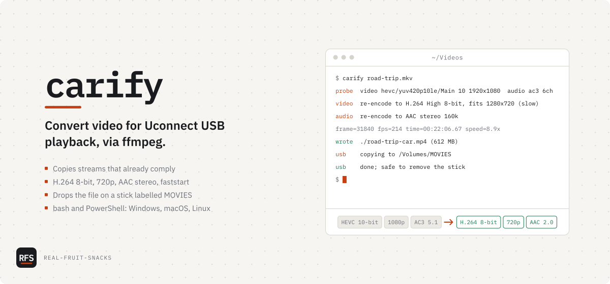

# carify

Convert video for Uconnect USB playback, via ffmpeg

<picture>
  <source media="(prefers-color-scheme: dark)" srcset="docs/assets/cover-dark.svg">
  
</picture>

```sh
curl -fsSL https://raw.githubusercontent.com/Real-Fruit-Snacks/carify/main/install.sh | sh
```

```powershell
irm https://raw.githubusercontent.com/Real-Fruit-Snacks/carify/main/install.ps1 | iex
```

Both need [ffmpeg](https://ffmpeg.org/) on your PATH: `winget install Gyan.FFmpeg`, `sudo apt install ffmpeg`, `sudo dnf install ffmpeg` or `brew install ffmpeg`.

The Uconnect head units in Chrysler, Jeep, Dodge and Ram vehicles play MP4 files from a USB stick, but only 8-bit H.264 at 720p or smaller with AAC stereo audio. Anything else shows up as an unsupported file or plays without sound. I wrote carify so I could stop re-learning the ffmpeg flags for that: it probes the file, re-encodes only the streams that don't comply, and copies the result onto the stick.

## What's in it

| File | Does |
|---|---|
| `carify` | The converter, bash 3.2 or later: Linux, macOS, WSL |
| `carify.ps1` | The same converter for Windows PowerShell 5.1 and PowerShell 7 |
| `install.sh` | Puts `carify` in `~/.local/bin` and checks for ffmpeg |
| `install.ps1` | Puts `carify.ps1` in `$HOME\bin`, adds it to your user PATH, allows local scripts |
| `tests/run.sh` | Builds small fixture videos with ffmpeg and checks what either script makes of them |

```sh
carify movie.mkv                  # writes movie-car.mp4 next to the input
carify movie.mkv ~/out.mp4        # explicit output path
carify --force movie.mkv          # overwrite an existing output
carify --max-height 1080 movie.mkv
carify --no-usb movie.mkv         # don't copy to the stick
```

PowerShell takes the same arguments as `-Force`, `-MaxHeight 1080`, `-NoUsb` and `-Version`. `Get-Help carify.ps1` shows the full help.

What happens to a file:

1. `ffprobe` reads the first video stream (cover art is skipped) and the first audio stream.
2. Video is copied when it is H.264, `yuv420p`, Baseline/Main/High profile, level 4.1 or lower, and fits 1280x720. Otherwise it is re-encoded with `libx264 -preset veryfast -crf 20 -profile:v high -level:v 4.1` and scaled down to fit the box, aspect ratio kept. Nothing is scaled up.
3. Audio is copied when it is AAC with two channels or fewer. Otherwise it becomes AAC stereo at 160 kbps. A file with no audio track is converted silent, with a warning.
4. Subtitles, attachments and extra audio tracks are dropped.
5. The MP4 is written with `-movflags +faststart` to a hidden `.part` file and renamed when ffmpeg finishes, so a cancelled run leaves nothing half-written.
6. If a stick labelled **MOVIES** is mounted, the file is copied onto it. Rename your stick once and you never drag files again.

A file that already complies takes seconds. A re-encode takes as long as libx264 needs on your machine.

## Tested on

- Ubuntu 24.04 · bash 5.2 · ffmpeg 6.1.1 (all 40 checks in `tests/run.sh`)
- CI on every push: Ubuntu (bash, PowerShell 7), macOS (bash 5 and the system `/bin/bash` 3.2), Windows (PowerShell 7 and Windows PowerShell 5.1)
- *Not* tested: a list of head units by model year. The limits above are the common denominator that has worked across Uconnect generations, not a published spec.

## Known issues

- HDR sources (HDR10, HLG) are not tone-mapped. carify warns, and the result looks washed out.
- Only the first audio track is kept. If that is commentary or the wrong language, pick the track with ffmpeg yourself.
- Subtitles are dropped, not burned in.
- FAT32 sticks cannot hold files over 4 GB. carify says so when the copy fails; format the stick as exFAT or use a lower `--max-height`.
- One file per run. For a folder: `for f in *.mkv; do carify "$f"; done` or `Get-ChildItem *.mkv | ForEach-Object { carify.ps1 $_.FullName }`.

## Configuration

| Setting | Default | Does |
|---|---|---|
| `--max-height` / `-MaxHeight` | `720` | Largest frame height. Width limit is height x 16/9. Try `1080` if your unit handles it. |
| `CARIFY_USB_DIR` | unset | Copy to this folder instead of looking for a MOVIES stick |
| `CARIFY_THEME` | `nightshift` | `dayshift` for light terminal backgrounds |
| `NO_COLOR` | unset | Any value turns colour off |

The installers also read `CARIFY_BIN` (install folder) and `CARIFY_REF` (a tag such as `v1.1.1` instead of `main`).

## License

[MIT](LICENSE)
